# Post-contenido 1 — Unidad 10: Memorias del Computador

**Arquitectura de Computadores · Unidad 10 · Post-contenido**

| Dato | Valor |
|---|---|
| Estudiante | Juan Camilo Durán Bohórquez |
| Código | 1152532 |
| Repositorio | duran-post1-u10 |

## Descripción del laboratorio

El laboratorio tiene dos partes en un mismo repositorio y todo se hizo en C sobre Linux. En la Parte 1 el estudiante armó un benchmark que mide la latencia de acceso a memoria con arrays de varios tamaños, primero secuencial, luego aleatorio con mezcla `Fisher-Yates` y al final con stride fijo para ver los conflictos de asociatividad de la caché. En la Parte 2 el estudiante miró por dentro la memoria virtual de un proceso usando `/proc/PID/maps`, `/proc/PID/smaps` y `pmap -x`, vio crecer el `VmRSS` con page faults y midió cuánto cuesta un solo minor page fault con `mmap`.

## Estructura del repositorio

```
duran-post1-u10/
├── README.md
├── cache_bench.c          Parte 1
├── mymaps.c               Parte 2, paso 1
├── pagefault_demo.c       Parte 2, paso 3
├── mmap_fault_cost.c      Parte 2, paso 4 y 6
├── ejecutar_lab.sh        corre todo y guarda las salidas
├── resultados/            salidas de texto de cada experimento
└── capturas/              capturas de la consola de la VM, dos por checkpoint
```

## Entorno de compilación

| Elemento | Valor |
|---|---|
| Equipo anfitrión | Windows con 12th Gen Intel Core i7-1255U |
| Máquina virtual | VirtualBox, VM lab9 con 2 CPU y 2 GB de RAM |
| Sistema | Alpine Linux 3.19.9, kernel 6.6.142-0-lts, librería C musl |
| Compilador | gcc 13.2.1 |
| Herramientas | `pmap` y `vmstat` de procps, `free`, `time` de busybox, `strace` |

El equipo no tiene WSL, entonces el estudiante usó la VM de Alpine que ya tenía del laboratorio de la Unidad 5, le cambió el nombre a lab9 y le instaló `build-base`, `bash`, `procps`, `strace` y `util-linux` con `apk`. La guía dice Ubuntu o equivalente, Alpine sirve igual porque tiene el mismo `/proc` y el mismo kernel Linux, la diferencia es que usa musl en vez de glibc y eso se nota en algunos resultados. Para repetir todo basta con `bash ejecutar_lab.sh` desde la carpeta del repo, el script copia los fuentes a `~/u10post1` y `~/u10post2`, compila y deja las salidas en `resultados/`.

---

# Parte 1: Benchmark de Jerarquía de Caché

## Paso 1: Detección de los niveles de caché

Se creó `~/u10post1` y se leyó `/sys/devices/system/cpu/cpu0/cache/`. Además del tamaño se sacaron las vías, el tamaño de línea y los sets porque eso se necesita después para el stride.

| Nivel | Tamaño | Vías | Línea | Sets |
|---|---|---|---|---|
| L1d | 48 KB | 12 | 64 B | 64 |
| L1i | 32 KB | 8 | 64 B | 64 |
| L2 | 1280 KB | 10 | 64 B | 2048 |
| L3 | 12288 KB | 12 | 64 B | 16384 |

Lo primero que se notó es que este i7 no tiene la caché típica de la guía, la L1d es de 48 KB con 12 vías y no de 32 KB con 8. Igual al hacer la cuenta 48 KB entre 12 vías da 4096 B, o sea que cada vía mide lo mismo que una página y el stride de 4096 sigue sirviendo. La VM ve la misma caché del procesador real porque VirtualBox le pasa esos datos tal cual.

**Checkpoint 1**

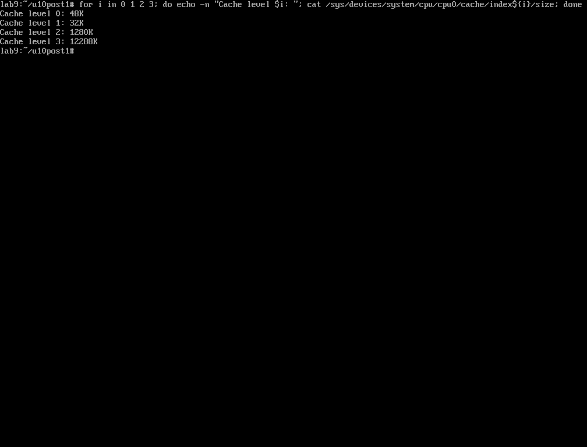
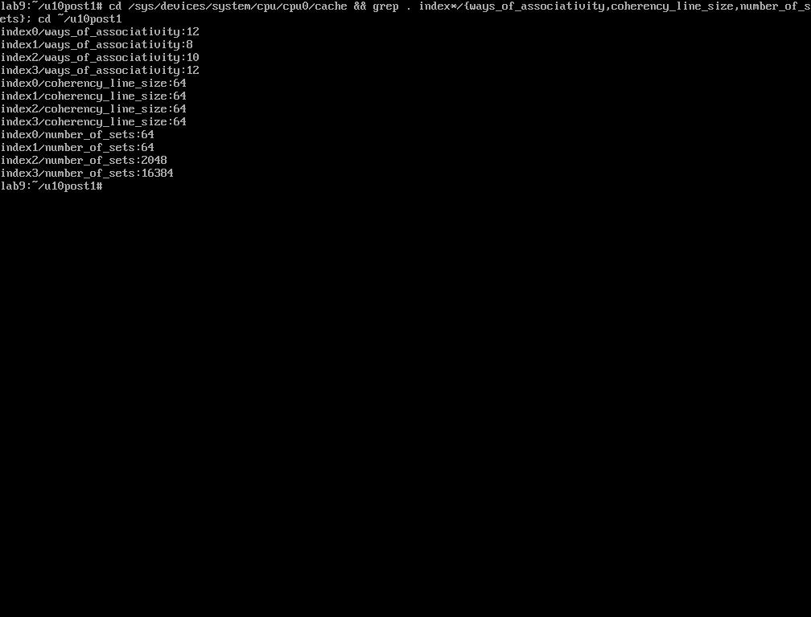

## Paso 2: Latencia por tamaño con acceso secuencial

Se escribió `bench_seq` en `cache_bench.c`, recorre el array byte por byte 100 veces y divide el tiempo de `clock_gettime` entre los bytes leídos. Se compiló con `gcc -O0` para que el compilador no borre los accesos, el `volatile` ayuda en lo mismo.

| Array KB | seq `ns/byte` | Nivel esperado |
|---|---|---|
| 4 | 0.902 | L1 |
| 8 | 0.880 | L1 |
| 16 | 0.987 | L1 |
| 32 | 1.104 | L1, cerca del fin de L1d |
| 64 | 1.004 | L2 |
| 128 | 1.044 | L2 |
| 256 | 0.944 | L2 |
| 512 | 0.891 | L2 |
| 1024 | 0.920 | L2, cerca del fin de L2 |
| 4096 | 0.942 | L3 |
| 16384 | 0.931 | RAM |
| 65536 | 0.941 | RAM |

Acá salió algo raro al principio, la columna secuencial casi no cambia, se queda entre 0.88 y 1.10 `ns/byte` aunque el array pase de 4 KB a 64 MB. Después de pensarlo un rato tiene sentido, en secuencial cada línea de 64 B trae 64 bytes seguidos, entonces solo 1 de cada 64 accesos puede fallar, y encima el prefetcher de hardware ve el patrón y trae las líneas antes de que se pidan. Con `-O0` el costo del propio bucle pesa más que la memoria. Los saltos claros por nivel se ven en la columna aleatoria del paso 3, ahí se marcaron las transiciones con flechas en la captura.

**Checkpoint 2**

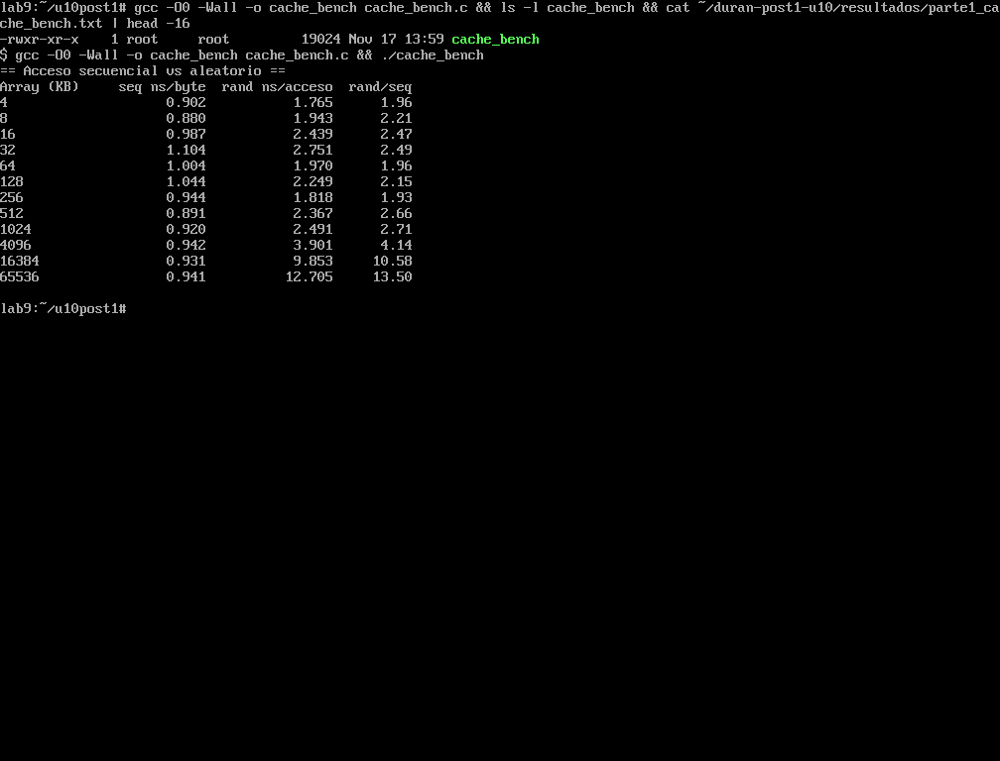
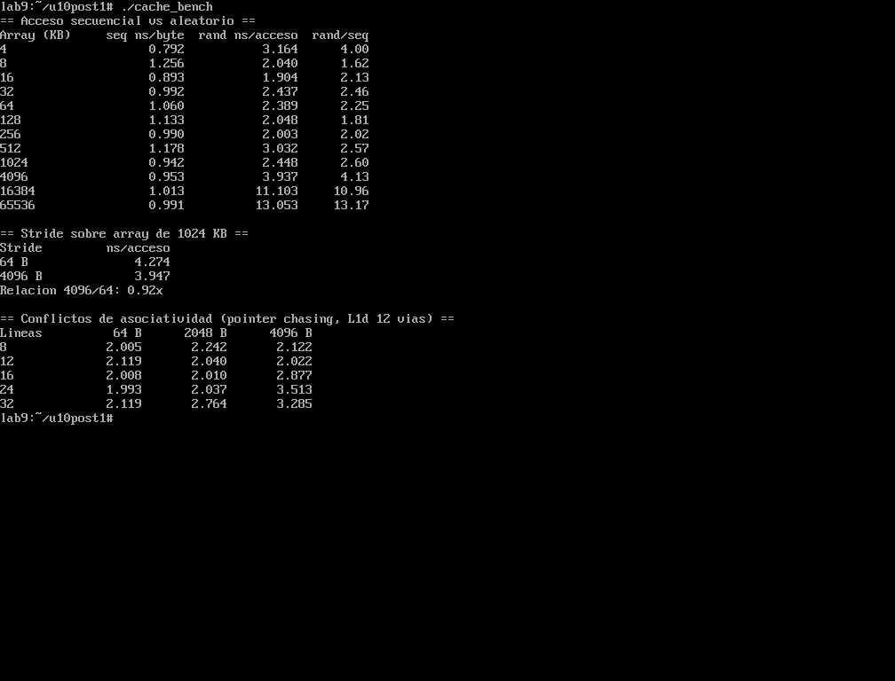

## Paso 3: Acceso aleatorio contra secuencial

Se agregó `bench_rand`, que primero mezcla un array de índices con `Fisher-Yates` y luego lee `arr[idx[i]]`. Así se rompe la localidad espacial y el prefetcher no puede adivinar la siguiente dirección.

| Array KB | seq `ns/byte` | rand `ns/acceso` | rand entre seq | Qué pasa |
|---|---|---|---|---|
| 4 a 256 | 0.88 a 1.10 | 1.77 a 2.75 | 1.9 a 2.5 | todo sale de L1 y L2, con ruido de la VM |
| 512 | 0.891 | 2.367 | 2.66 | el array más los índices ya llenan buena parte de L2 |
| 1024 | 0.920 | 2.491 | 2.71 | fin de L2, empieza el TLB miss |
| 4096 | 0.942 | 3.901 | 4.14 | salto a L3, cache miss en L2 |
| 16384 | 0.931 | 9.853 | 10.58 | salto a RAM, se pasa la L3 de 12 MB más TLB miss |
| 65536 | 0.941 | 12.705 | 13.50 | RAM y TLB miss casi siempre |

Hay tres saltos claros en la columna aleatoria. El primero va de 1024 KB a 4096 KB, cuando el array con su arreglo de índices deja de caber en los 1280 KB de L2 y cada acceso pasa a ser un cache miss de L2 resuelto en L3. El segundo y más grande va de 4 MB a 16 MB, ahí se pasa la L3 de 12 MB y cada acceso aleatorio tiene que ir a RAM, la latencia sube de 3.9 a 9.9 ns. Además desde 1 o 2 MB el array ocupa cientos de páginas de 4 KB y el TLB ya no alcanza, entonces aparte del cache miss hay un TLB miss y un page walk, por eso en 64 MB sigue subiendo a 12.7 ns. El salto de L1 a L2 no se ve tan marcado porque con `-O0` el bucle ya cuesta unos 2 ns por acceso y tapa la diferencia pequeña entre L1 y L2, y además la VM metía ruido. Se volvió a correr con `-O2` y ahí la columna aleatoria sí sube de forma pareja desde 128 KB, se ve en la segunda captura.

**Checkpoint 3**

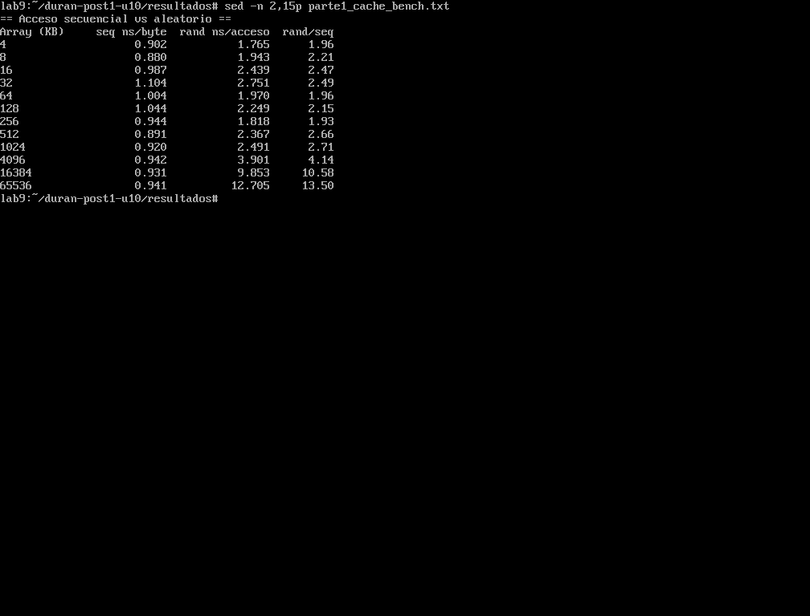
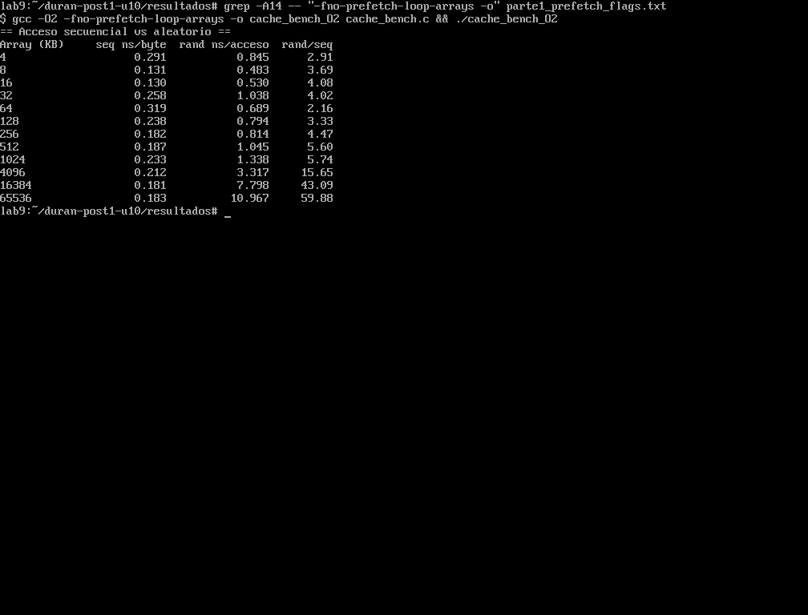

## Paso 4: Stride para exponer conflictos de asociatividad

Se agregó `bench_stride` tal cual la guía y se corrió sobre 1 MB con stride de 64 B y de 4096 B.

| Stride | `ns/acceso` |
|---|---|
| 64 B | 4.600 |
| 4096 B | 4.822 |

Esto no salió como decía la guía, los dos dan casi igual, apenas 1.05x. Revisando con calma se encontró la razón. El array de 1 MB no cabe en una L1d de 48 KB, así que con stride de 64 B igual se recorren 16384 líneas distintas y todas fallan en L1, el prefetcher las trae pero el costo queda parecido. Con stride de 4096 B son 256 líneas que se pelean el mismo set de L1, también fallan en L1, pero en L2 se reparten en 32 sets con 8 líneas cada uno y caben en sus 10 vías. Entonces los dos casos terminan sirviéndose desde L2 y por eso la diferencia casi no aparece, además el `%` del índice cuesta casi lo mismo que el acceso.

Para ver el conflicto de verdad se agregó `bench_conflict`, que usa pointer chasing, cada línea guarda la dirección de la siguiente y así cada carga depende de la anterior y no se puede esconder la latencia. Se probaron pocas líneas para que el tamaño total sea mínimo, por ejemplo 16 líneas con stride de 64 B son solo 1 KB.

| Líneas | 64 B | 2048 B | 4096 B |
|---|---|---|---|
| 8 | 2.157 | 2.329 | 2.179 |
| 12 | 1.999 | 2.064 | 3.201 |
| 16 | 2.026 | 2.024 | 4.880 |
| 24 | 2.028 | 3.374 | 3.669 |
| 32 | 2.001 | 3.660 | 3.865 |

Acá sí se ve. Con stride de 64 B nunca pasa nada, se queda en 2 ns porque las líneas caen en sets distintos. Con stride de 4096 B todas las líneas caen en el mismo set, con 8 líneas caben en las 12 vías y sale a 2.2 ns que es L1, con 12 ya queda justo y sube a 3.2, y desde 16 líneas pasa a entre 3.7 y 4.9 ns que es la latencia de L2. Eso es un conflict miss puro, porque 16 líneas son apenas 1 KB de datos útiles y la L1 tiene 48 KB, el problema es el set y no el tamaño. Con stride de 2048 B las 16 líneas todavía dan 2.0 ns y el salto llega recién con 24 líneas, justo el doble, porque se reparten entre 2 sets.

**Checkpoint 4**

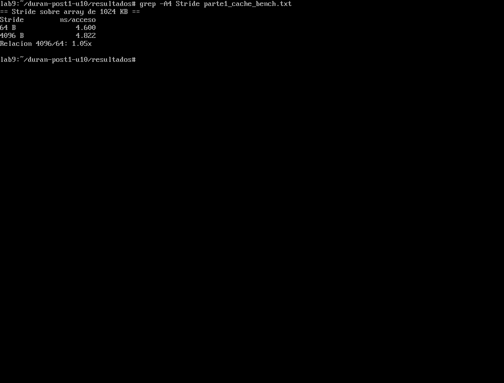
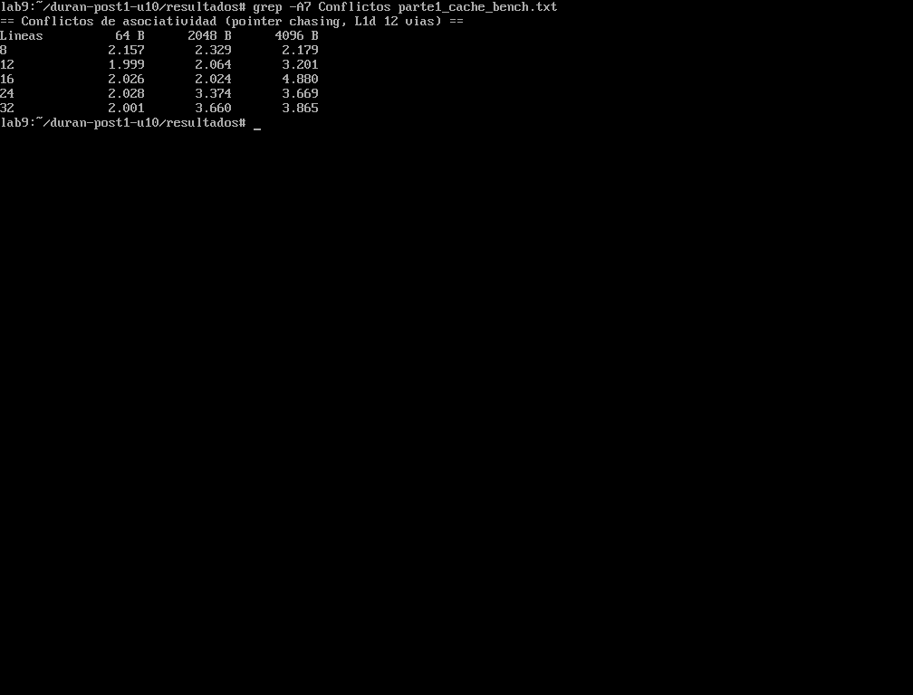

## Paso 5: Decisión técnica — ¿Qué stride expone mejor los conflictos de asociatividad en esta caché?

El índice de set sale de los bits de la dirección que están justo encima del offset de línea. Con líneas de 64 B el offset son los bits 0 a 5 y con 64 sets el índice son los bits 6 a 11. Para que todos los accesos caigan en el mismo set esos bits 6 a 11 tienen que quedar fijos, y eso pasa cuando el stride es múltiplo del tamaño de la caché dividido entre las vías. En la L1 de la guía da 32 KB entre 8 vías igual a 4096 B, y en la L1d de este i7 da 48 KB entre 12 vías, también 4096 B, que coincide con el tamaño de página. Si se usa un stride de 2048 B el bit 11 ya no queda fijo, va cambiando entre 0 y 1, entonces los accesos alternan entre 2 sets distintos y cada set recibe la mitad de las líneas. Por eso hacen falta el doble de líneas para agotar la asociatividad, cosa que se midió en el paso 4, con 2048 B el salto llegó en 24 líneas y con 4096 B en 16. Con stride de 4096 B sobre 1 MB hay 256 direcciones peleando un set de pocas líneas. Desde la línea 9 en la caché de 8 vías de la guía, o desde la 13 en esta de 12 vías, cada línea nueva tiene que desalojar a otra según la política de reemplazo. Cada acceso extra deja de salir de L1 y se resuelve en L2, en las mediciones pasó de unos 2 ns a casi 5 ns por acceso, mientras que el acceso secuencial del Checkpoint 2 se queda casi siempre en L1 con ayuda del prefetcher.

## Paso 6: Decisión técnica — ¿-fno-prefetch-loop-arrays deshabilita el mismo prefetching que el prefetcher de hardware?

El flag `-fno-prefetch-loop-arrays` solo le dice a gcc que no meta instrucciones de prefetch por software en los bucles, no toca para nada el prefetcher de hardware, que vive dentro del procesador y mira el patrón de direcciones en tiempo de ejecución sin importar qué binario corra. Para comprobarlo se miró el ensamblador con `-S`, con `-O2 -fprefetch-loop-arrays` aparecen 6 instrucciones `prefetcht0` y con `-fno-prefetch-loop-arrays` aparecen 0. Algo curioso es que gcc no puso ningún prefetch en `bench_seq`, porque el `volatile` no lo deja tocar ese bucle, y sí los puso en `bench_rand` pero en los bucles que llenan y recorren el arreglo de índices, que son secuenciales. En teoría el patrón más sensible al cambio sería el secuencial, porque es el único que el compilador puede predecir para insertar el prefetch, el aleatorio y el de stride de 4096 B son casi insensibles porque ningún prefetch hecho en compilación puede adivinar direcciones que salen de una mezcla `Fisher-Yates` o de un set saturado. Al correr las dos versiones las tablas salieron muy parecidas, el secuencial quedó entre 0.13 y 0.32 `ns/byte` en ambas y las diferencias subían y bajaban sin un sentido fijo, incluso el stride dio 1.68x en una corrida y 0.86x en la otra, o sea ruido de la VM. La conclusión que sí se puede sacar es limitada pero válida, la comparación mide solo el efecto del prefetch por software del compilador. El prefetcher de hardware sigue prendido en las dos corridas y para apagarlo de verdad habría que tocar registros MSR o la BIOS, cosa que gcc no puede hacer y que dentro de una VM ni siquiera se tiene a mano.

**Checkpoint 5**

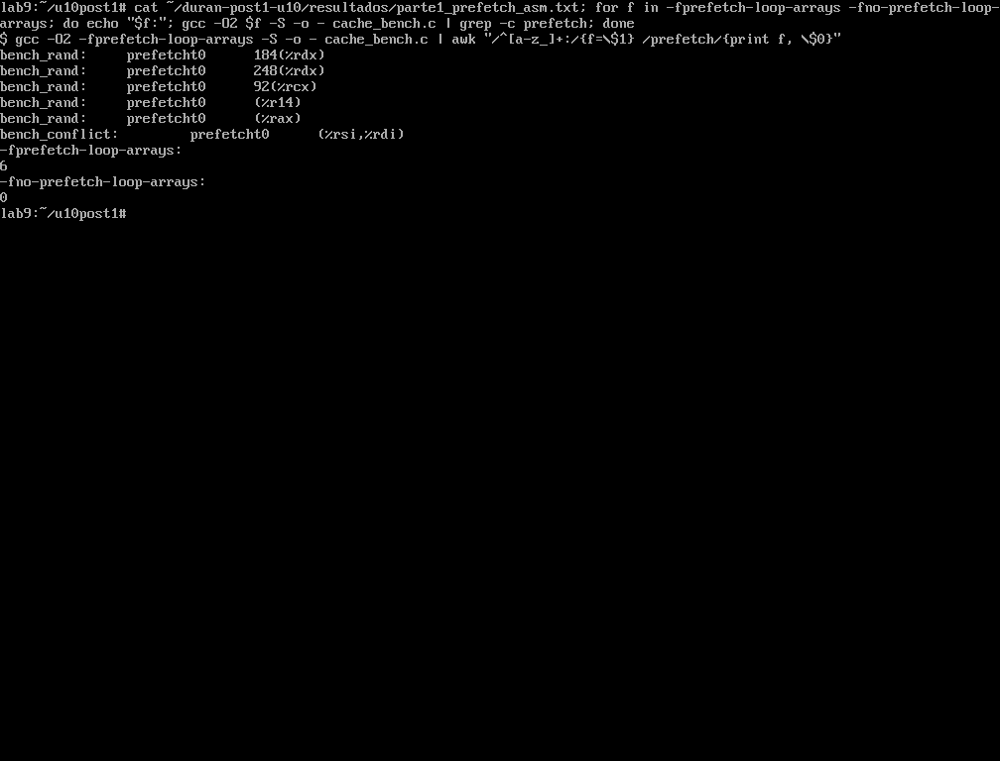
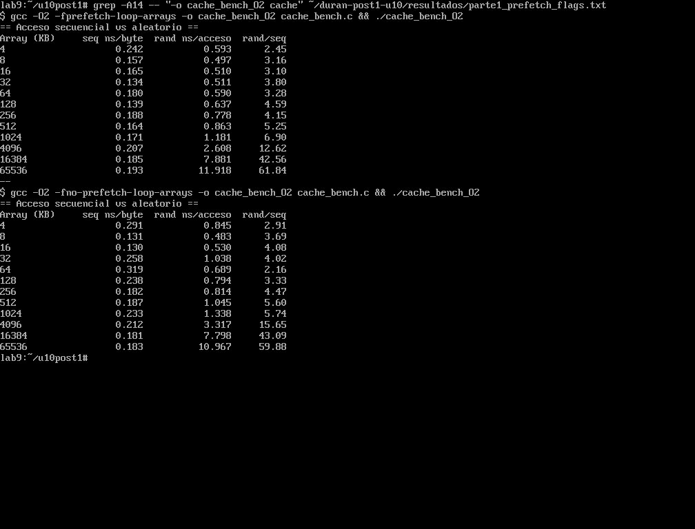

---

# Parte 2: Análisis de Memoria Virtual en Linux

## Paso 1: Mapa de memoria virtual de un proceso

Se creó `~/u10post2` con `mymaps.c`, que imprime direcciones de la pila, el heap y un global y se queda en `getchar()` para que el proceso siga vivo. Se lanzó en segundo plano con `&`, se leyó `/proc/$PID/maps` y luego se cerró con `kill`.

| Región | Rango | Permisos | Para qué sirve |
|---|---|---|---|
| Texto `.text` de mymaps | `564562f8c000-564562f8d000` | `r-xp` | código del programa, se lee y se ejecuta pero no se escribe |
| Solo lectura `.rodata` | `564562f8d000-564562f8e000` | `r--p` | constantes como la cadena `"hola"` |
| Datos `.data` y `.bss` | `564562f8f000-564562f90000` | `rw-p` | variables globales como `global_data` |
| Heap | `5645a0fe3000-5645a0fe4000` | `rw-p` | memoria dinámica pequeña de `malloc` |
| Anónimo de `malloc` | `7f72bff17000-7f72c0018000` | `rw-p` | el bloque de 1 MB |
| libc de musl | `7f72c002c000-7f72c007f000` | `r-xp` | código de `ld-musl-x86_64.so.1`, que en musl es libc y cargador a la vez |
| Pila | `7ffc686fb000-7ffc6871c000` | `rw-p` | variables locales, por ejemplo `heap` |
| vDSO | `7ffc68785000-7ffc68787000` | `r-xp` | código del kernel puesto en el proceso para llamar `clock_gettime` sin syscall |

Aquí se descubrieron varias cosas. Primero, en Alpine no aparece `libc.so.6` ni `ld-linux.so` como en Ubuntu, solo `ld-musl-x86_64.so.1`, porque en musl la libc y el cargador dinámico son el mismo archivo. Segundo, el bloque de 1 MB no quedó en `[heap]`, la dirección que imprimió `malloc` es `0x7f72bff17020` y cae en una región anónima de 1028 KB al lado de la librería. Eso pasa porque el `malloc` usa `mmap` en vez de `brk` cuando el pedido es grande, por eso el `[heap]` solo tiene dos páginas, una `---p` de guarda y otra `rw-p`. También se ve la `p` de privado en casi todo, y que la pila está arriba del todo y crece hacia abajo.

**Checkpoint 1**

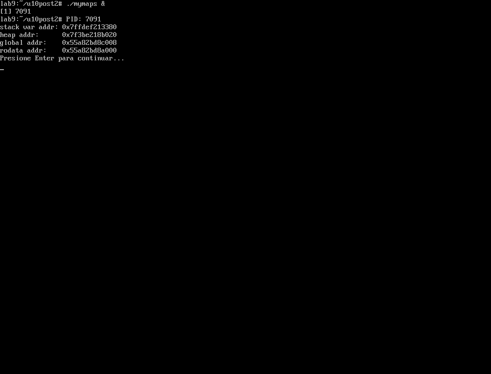
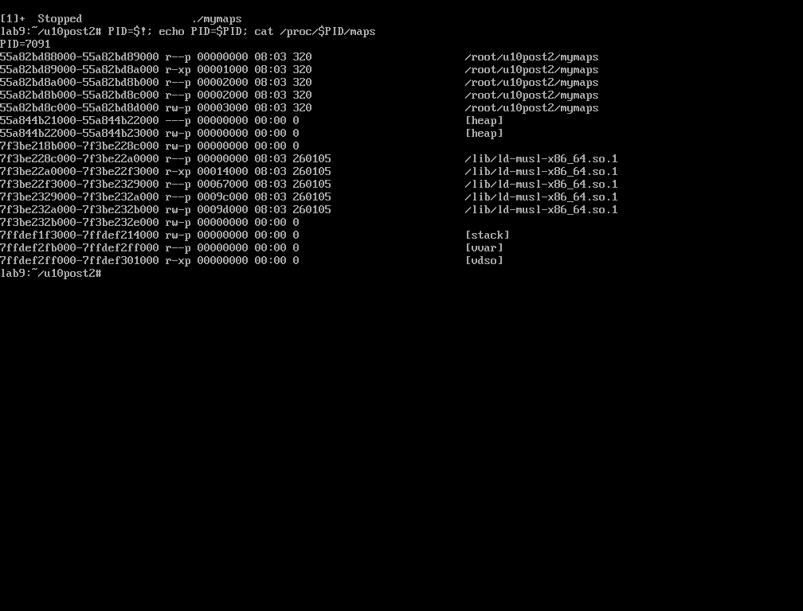

## Paso 2: Clasificación de páginas con smaps y pmap

Se leyó `/proc/$PID/smaps` filtrando el heap, el código de la libc y la pila, y se sacó `pmap -x` del mismo proceso, además de `vmstat -s` y `free -h` para ver el sistema completo.

| Región | Size | Rss | Shared_Clean | Private_Dirty | Fuente |
|---|---|---|---|---|---|
| `[heap]` `rw-p` | 4 kB | 4 kB | 0 kB | 4 kB | smaps |
| `[stack]` | 132 kB | 12 kB | 0 kB | 12 kB | smaps |
| `ld-musl` `r-x` | 332 kB | 332 kB | 332 kB | 0 kB | smaps |

El heap y la pila salen como `Private_Dirty` porque son páginas anónimas que solo este proceso escribió, no hay archivo detrás de donde volver a leerlas, así que si el kernel las quiere sacar de RAM tendría que mandarlas a swap, además nadie más las puede usar. Al principio el filtro de `smaps` buscaba `libc` en el nombre y como en musl se llama `ld-musl` no la atrapaba, se corrigió el filtro y se repitió la captura. Ahí el código de `ld-musl` sale con 332 kB en `Shared_Clean` y 0 kB en `Private_Dirty`. Ese código es una copia del archivo en el page cache que nunca se modifica, todos los procesos de Alpine la mapean al mismo marco físico, así que son `Shared_Clean`, y si hace falta memoria el kernel las bota y las vuelve a leer del disco sin perder nada. En `pmap -x` el total dio 1860 kB virtuales y solo 472 kB residentes, menos de la tercera parte del espacio reservado llegó a RAM. `free -h` mostró 1.9 GB de RAM en la VM con 1.9 GB de swap sin usar.

**Checkpoint 2**

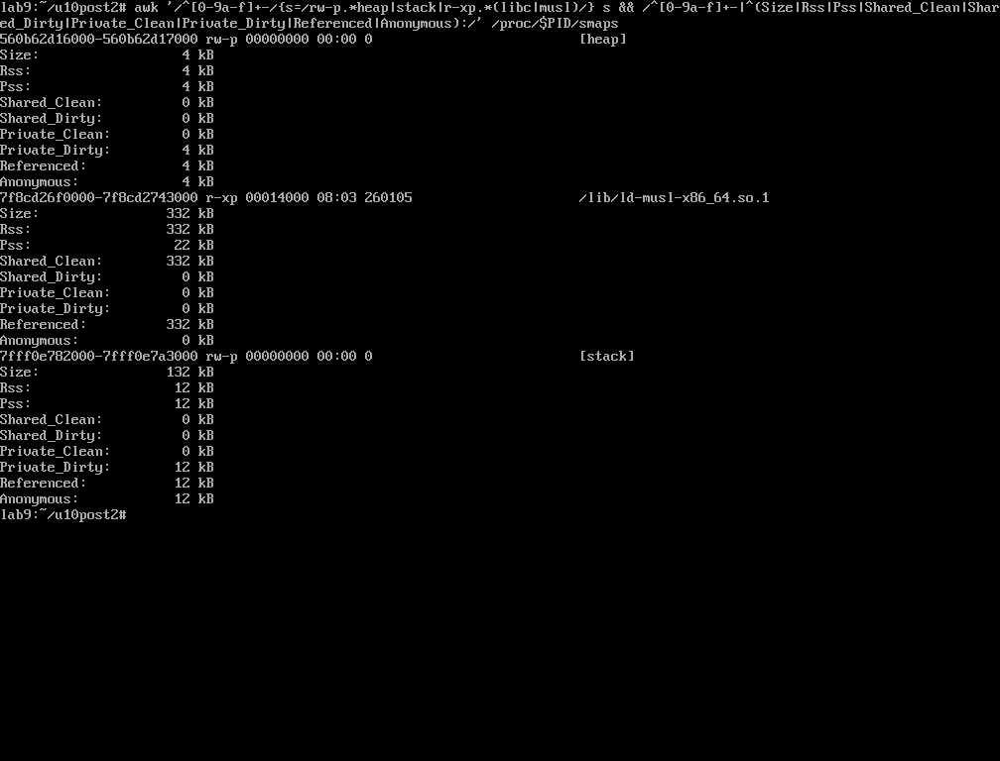
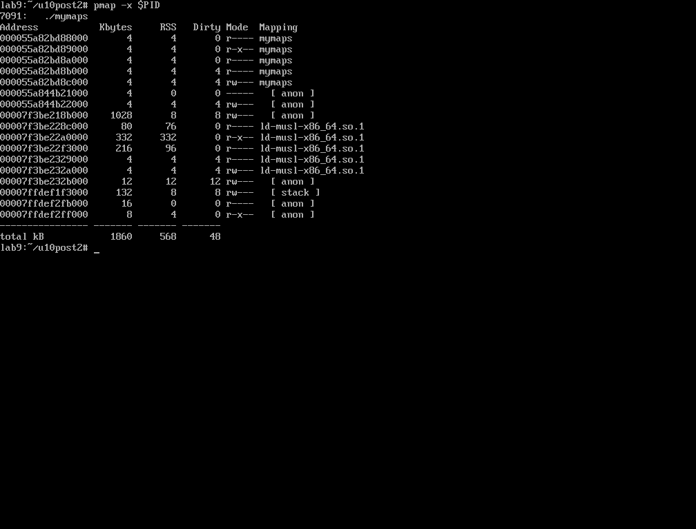
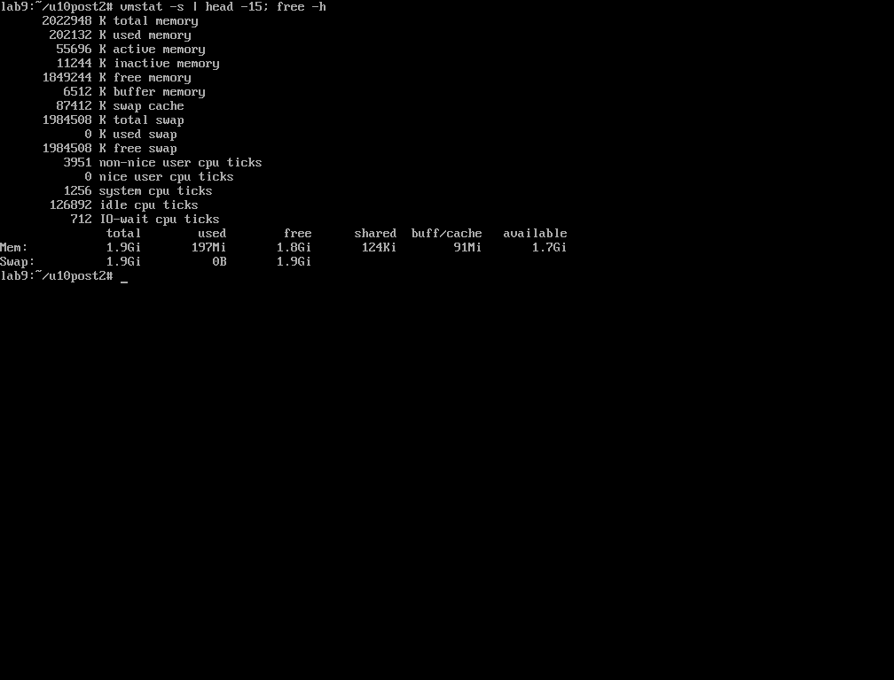

## Paso 3: Page faults y crecimiento de VmRSS

Con el código de la guía tal cual, probándolo antes en otro Linux, pasó algo raro, el `VmRSS` salía igual antes y después del `memset` y el `VmSize` daba solo 3.5 MB aunque se pidieron 100 MB. La razón es que `system()` lanza un `sh` que lanza `grep`, y para `grep` el `/proc/self` es el propio `grep`, no `pagefault_demo`. Por eso se cambió a leer `/proc/self/status` con `fopen` desde el mismo proceso, en `pagefault_demo.c` quedó comentado.

| Momento | VmSize | VmRSS |
|---|---|---|
| Antes del `memset` | 103240 kB | 484 kB |
| Después del `memset` | 103240 kB | 102880 kB |

Antes del `memset` los 100 MB ya están reservados, se ve en el `VmSize`, pero no están en RAM. Eso es la asignación diferida o demand paging, `malloc` solo reserva direcciones virtuales y el kernel no le da marcos físicos hasta que se toca cada página. El `memset` escribe en las 25600 páginas de 4 KB y por eso el `VmRSS` sube unos 100 MB. Con `/usr/bin/time -v` salió `Major (requiring I/O) page faults` en 0 y `Minor (reclaiming a frame) page faults` en 590. Ese 590 sorprendió porque se esperaban unos 25600, la sospecha es que el kernel usó transparent huge pages de 2 MB para este bloque anónimo grande, así cada fault llena 512 páginas de golpe, 100 MB entre 2 MB son unos 50 faults y el resto son del arranque del programa. Otro detalle es que en Alpine no hay GNU time, el `time` es el de busybox y su `Maximum resident set size` dio 411200 kB, unas 4 veces el `VmRSS` real, eso es un error de busybox y no del programa. Un minor fault se arregla sin disco, el kernel solo toma un marco libre y lo pone en la tabla de páginas. Un major fault sí tiene que leer del disco, por ejemplo desde swap o desde un archivo que no estaba en caché, y aquí no hubo ninguno porque había RAM de sobra.

**Checkpoint 3**

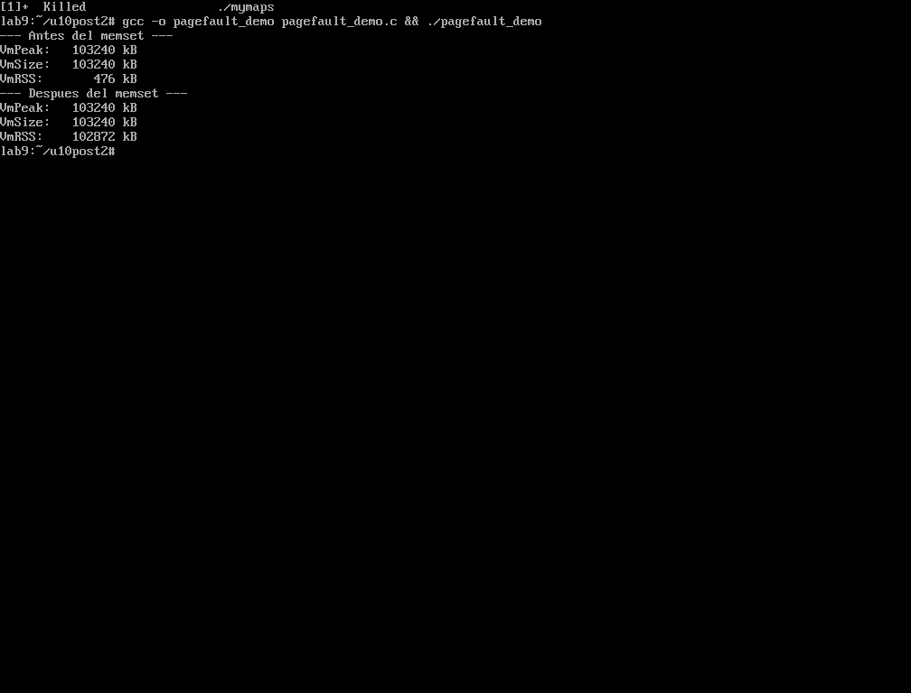
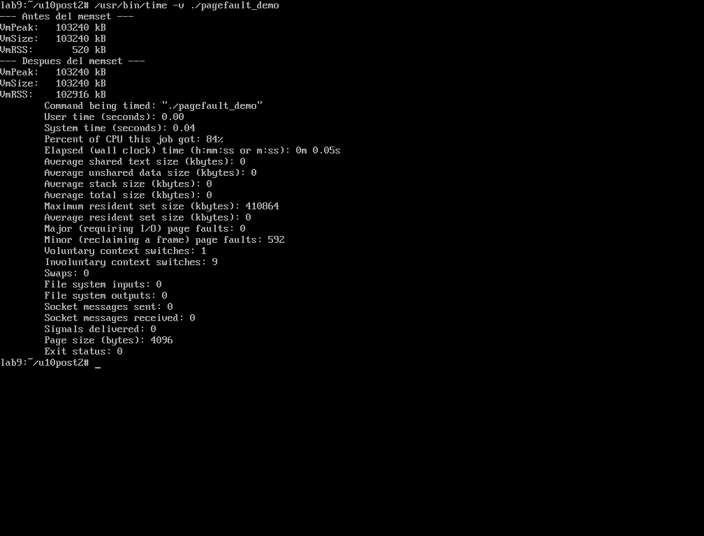

## Paso 4: Costo de un page fault individual con mmap

Se creó `mmap_fault_cost.c`, que hace un `mmap` anónimo de 200 páginas y mide con `clock_gettime` el primer toque de cada página y el segundo toque. Se corrió 3 veces en el script y una vez más en vivo para la captura.

| Corrida | Primer toque | Segundo toque | Overhead del fault |
|---|---|---|---|
| 1 | 1900.0 ns | 30.3 ns | 1869.7 ns |
| 2 | 1707.4 ns | 29.3 ns | 1678.1 ns |
| 3 | 1585.3 ns | 28.5 ns | 1556.9 ns |
| Captura en vivo | 3530.8 ns | 44.1 ns | 3486.8 ns |

El primer toque cuesta entre 1500 y 3500 ns porque incluye el trap al kernel, buscar un marco libre, ponerlo en cero y actualizar la tabla de páginas, y dentro de una VM eso es más caro porque también hay que tocar las tablas de páginas del hipervisor. La corrida en vivo salió más alta porque el anfitrión le estaba quitando CPU a la VM, en esos minutos el kernel avisó varios soft lockup. El segundo toque baja a unos 30 ns, que en realidad es casi todo el costo de las dos llamadas a `clock_gettime`, porque la traducción ya está en la tabla y seguramente en el TLB. Comparando con la Parte 1, un acceso aleatorio a RAM costó entre 10 y 13 ns, entonces un minor page fault vale lo mismo que unos 150 accesos a RAM, más o menos dos órdenes de magnitud más.

**Checkpoint 4**

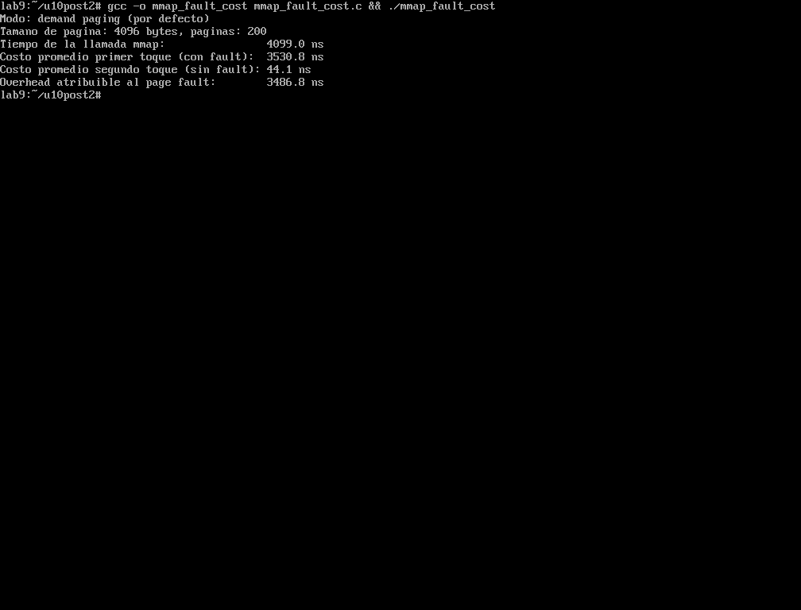
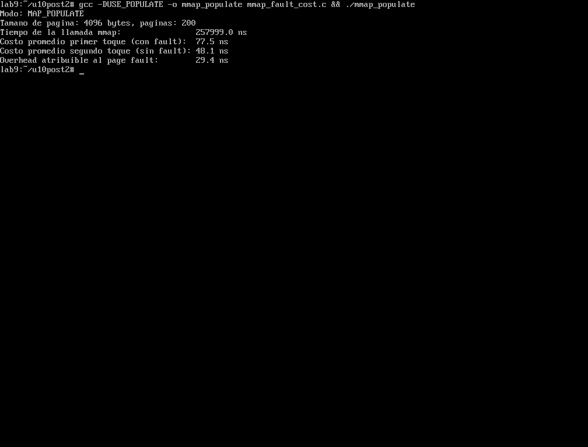

## Paso 5: Decisión técnica — ¿/proc/PID/smaps o pmap -x para este análisis?

Si lo único que se quiere es saber cuánta RAM usa cada región, `pmap -x` sí lo dice, trae la columna `RSS` y también `Dirty` por región. Lo que no trae es la separación entre `Private_Dirty`, `Private_Clean`, `Shared_Clean` y `Shared_Dirty`, ni el campo `Referenced`, ni `Pss`, ni `Anonymous`, y justo esos campos son los que hacen falta en el Checkpoint 2 para decir por qué una región es compartida y otra privada. En este laboratorio se notó, con `pmap -x` solo se ve que el código de la libc está limpio por la columna `Dirty` en 0, pero no si es compartido o privado, eso solo lo dijo `smaps`. Para un script que vigila un proceso cada segundo el volumen sí importa, `smaps` del shell tuvo 725 líneas contra 29 de `maps`, y guardar o filtrar eso cada segundo es pesado, ahí conviene el resumen corto de `pmap -x` o mejor `smaps_rollup`. Al medirlo salió algo que no esperaba la guía, 500 lecturas tardaron 0.547 s con `cat smaps` y 0.998 s con `pmap -x`, porque `pmap` igual tiene que leer la información de `/proc` del proceso y además se paga lanzar otro programa. Se intentó ver con `strace` qué archivo abre `pmap` pero no salió nada, se cree que musl usa la syscall `open` y el filtro buscaba `openat`. La ventaja real de `pmap -x` es que entrega la tabla ya armada con totales sin escribir `grep` ni `awk`, para una mirada rápida en la terminal es lo más cómodo. Leer `smaps` directo es preferible cuando hay que clasificar el tipo de página región por región, como en este laboratorio.

**Checkpoint 5**

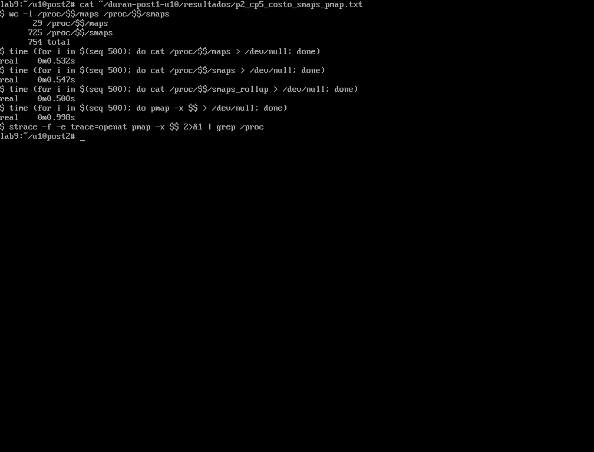


## Paso 6: Decisión técnica — ¿mmap con MAP_POPULATE o demand paging por defecto?

Para probarlo se compiló el mismo `mmap_fault_cost.c` con `-DUSE_POPULATE`, que le agrega `MAP_POPULATE` a las banderas, y se midió también el tiempo de la llamada a `mmap`. Con demand paging la llamada tardó entre 2484 y 3499 ns y el primer toque costó entre 1585 y 1900 ns. Con `MAP_POPULATE` la llamada subió a entre 200672 y 256914 ns, unas 70 veces más, pero el primer toque bajó a unos 53 ns, casi igual que el segundo toque, y el overhead del fault quedó en unos 20 ns. O sea que el costo no desaparece, se paga todo por adelantado dentro de `mmap` porque el kernel llena las tablas de páginas del rango completo de una vez. Eso conviene en un servidor que atiende peticiones y necesita latencia baja y predecible, porque así ninguna petición se come un page fault en medio, el arranque es más lento pero luego todo es parejo. El demand paging por defecto conviene a programas que reservan memoria de forma generosa o especulativa y no saben cuánto van a usar. Si un proceso reserva 100 MB pero solo toca 10 MB, con demand paging solo se gastan los marcos y el tiempo de esos 10 MB, mientras que con `MAP_POPULATE` se asignan y se ponen en cero los 100 MB completos, se gastan 90 MB de RAM física y el tiempo de unas 23000 páginas que nunca se usaron. En una VM con 2 GB como esta ese desperdicio pesa bastante.

---

## Comportamiento observado

- La VM tuvo varios avisos de soft lockup del kernel, el anfitrión le quitaba CPU a VirtualBox. La primera corrida del script salió con mucho ruido y se repitió con la consola quieta, `resultados/` es esa segunda corrida. Aun así los ns cambian bastante entre corridas.
- En Alpine el `time` es el de busybox, acepta `-v` pero su `Maximum resident set size` sale inflado.
- Alpine usa musl, por eso en `maps` aparece `ld-musl-x86_64.so.1` en lugar de `libc.so.6` y `ld-linux.so`.
- La versión de `pagefault_demo.c` de la guía mide el `grep` y no el propio programa, se corrigió leyendo `/proc/self/status` con `fopen`.

## Commits

| Parte | Commit |
|---|---|
| Parte 1 | `feat: detección de caché y bench_seq secuencial` |
| Parte 1 | `feat: bench_rand con mezcla Fisher-Yates` |
| Parte 1 | `feat: bench_stride y bench_conflict para asociatividad` |
| Parte 2 | `feat: mymaps.c para leer /proc/PID/maps` |
| Parte 2 | `feat: pagefault_demo.c con VmRSS leído desde el propio proceso` |
| Parte 2 | `feat: mmap_fault_cost.c con MAP_POPULATE y README final` |

## Referencias

Bryant, R. E., & O'Hallaron, D. R. (2016). *Computer systems: A programmer's perspective* (3rd ed.). Pearson.

Drepper, U. (2007). *What every programmer should know about memory*. Red Hat. https://people.freebsd.org/~lstewart/articles/cpumemory.pdf

Free Software Foundation. (2024). *Using the GNU Compiler Collection: Optimize options*. https://gcc.gnu.org/onlinedocs/gcc/Optimize-Options.html

Kerrisk, M. (2024). *proc_pid_smaps(5) — Linux manual page*. https://man7.org/linux/man-pages/man5/proc_pid_smaps.5.html

Kerrisk, M. (2024). *mmap(2) — Linux manual page*. https://man7.org/linux/man-pages/man2/mmap.2.html

Patterson, D. A., & Hennessy, J. L. (2020). *Computer organization and design: The hardware/software interface* (RISC-V ed., 2nd ed.). Morgan Kaufmann.
